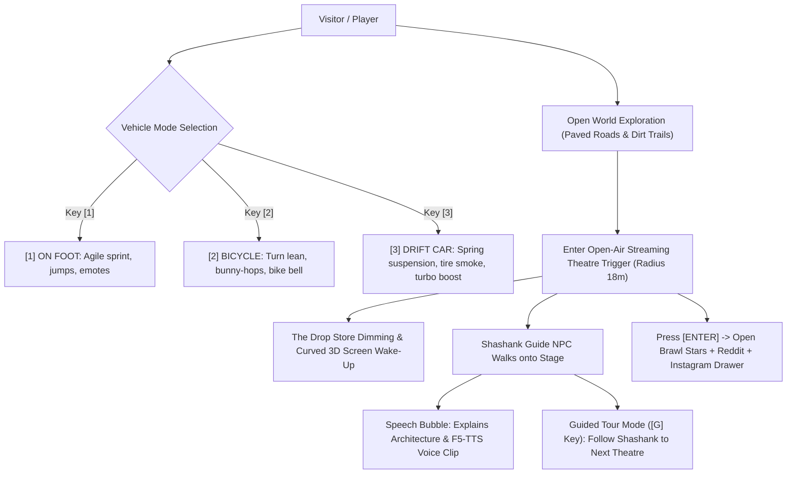
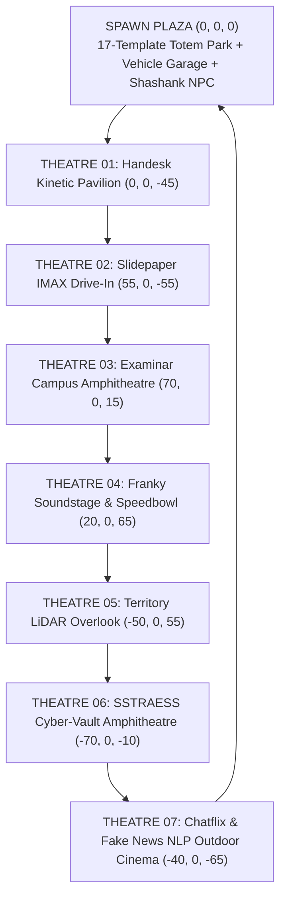

# GAME_ARCHITECTURE.md — The Reverse-Engineered Realm: 3D Playable Open-World Portfolio Game

> **Creator & Protagonist:** Shashank S (@Shashankinfernape — https://github.com/Shashankinfernape)  
> **Aesthetic Foundation:** Playful cel-shaded open-world playground inspired by *Messenger by Abeto*, fused with F1 telemetry (*Lando Norris*), neo-brutalist game loadouts (*Brawl Stars*), isometric base overview (*Clash of Clans*), and 17 forensic reverse-engineered web/app templates.

---

## 1. The 17 Harvested Local Engineering Templates

The open world directly manifests the forensic discoveries extracted from `Desktop/El projecto/Git-repos/`:

| Index | Template / Analysis Folder | Harvested Architectural Mechanics & Shaders | In-Game Manifestation |
|---|---|---|---|
| **01** | `abeto-messenger-engineering-template/` | Cel-shaded Toon materials, warm palette, NPC speech bubbles, responsive third-person camera, dust puffs | Core world engine, NPC dialogue bubbles, character aesthetics |
| **02** | `igloo-inc-analysis/` | Procedural Voronoi crystal facets, chromatic RGB aberration, frost dissolve, velocity motes | Theatre stage crystal pillars, screen wake-up transitions |
| **03** | `lusion-engineering-template/` | Spring-damper physics, fluid audio-reactive distortion, transmission glass | Franky Speedbowl ferrofluid soundstage, camera damping |
| **04** | `into-the-amazon-engineering-template/` | LiDAR point cloud shaders, radar elevation minimap, additive depth fog | Territory Overlook geospatial elevation radar, 3D building pop-ups |
| **05** | `pixelflakes-engineering-template/` | Wireframe blueprint to solid geometry mesh transitions | Theatre entrance preloader, X-Ray debug mode transitions |
| **06** | `why-zero-university-engineering-template/` | Open-air campus amphitheatre, concentric lecture terraces, floating books | Examinar Campus Amphitheatre with floating paper airplanes |
| **07** | `dont-board-me-engineering-template/` | Destructible physics props, impact velocity impulse, knock-over dominoes | Physics bowling pins, knock-over keycaps, jump ramps |
| **08** | `landonorris-engineering-template/` | F1 speedometer (`KM/H`), gear indicator, drift angle telemetry, papaya accent | In-game driving telemetry HUD, car drift tire smoke |
| **09** | `display-studio-engineering-template/` | Minimalist keyboard-driven fast-travel dock, sector index | Instant theatre dock and map fast-travel |
| **10** | `other-side-of-truth-analysis/` | `[R]` Global X-Ray UV wireframe shader override | Global reverse-engineering inspection toggle |
| **11** | `self-aware-analysis/` | Spatial CAD gizmos, articulated robotic coordinate frames | Handesk pavilion articulated 3D cyber-hand tracker |
| **12** | `brawl-stars-analysis/` | Skewed neo-brutalist cards, Lilita One typography, rarity badges, stat bars | Project inspect drawer with animated stat bars |
| **13** | `clash-of-clans-analysis/` | `[M]` Isometric village overview camera, building level badges | Isometric world camera mode with building badges |
| **14** | `reddit-engineering-template/` & `reddit/` | Collapsible nested Dev-Log comment trees, upvote metrics, OP flairs | `r/ShashankBuilds` engineering post-mortem comment threads |
| **15** | `instagram-engineering-template/` & `instagram/` | Top Stories gradient ring fast-travel, vertical Reels project preview | Top screen fast-warp rings, live streaming project screens |
| **16** | `igloo-inc-analysis/` | Velocity-reactive morphing footer particles | Vehicle speed-reactive exhaust motes |
| **17** | `why-zero-university-engineering-template/` | Sculpted outdoor plazas and radial stone seating | Open-air drive-in / walk-in stage seating terraces |

---

## 2. Core Gameplay Loop: Vehicle Controller & In-Game Guide

---

## 3. World Layout & Spatial Map

All locations are situated on a loopable continuous circuit connected by asphalt drift roads, ramps, and bicycle trails:

---

## 4. Technical Component Pipeline

1. **`src/store/useGameStore.ts`**:
   - Manages player vehicle mode (`ON_FOOT`, `BICYCLE`, `DRIFT_CAR`), speed, heading, drift angle, gear.
   - Manages camera modes (`THIRD_PERSON_FOLLOW`, `ISOMETRIC_CLASH`).
   - Manages Shashank Guide NPC position, guided tour state (`isFollowingGuide`), active theatre index.
   - Manages UI modals (Brawl/Reddit drawer, 17-studies archive, 60s recruiter drawer, teleport map).
2. **`src/canvas/PlayerVehicleController.tsx`**:
   - High-performance locomotion with chassis pitch/roll, wheel angular velocity, drift smoke particles, bunny-hop vertical physics, and smooth spring camera.
3. **`src/canvas/ShashankGuideNPC.tsx`**:
   - Stylized 3D avatar of Shashank S, speech bubbles with sound triggers, path interpolation to each theatre stage.
4. **`src/canvas/OpenAirTheatre.tsx`**:
   - Curved 3D cinema screen with procedural canvas shaders, proximity spotlighting, and marquee headers.
5. **`src/canvas/InteractiveArtProps.tsx`**:
   - 17 kinetic totems at Spawn, physics dominoes, stunt jump ramps, and custom props for all 7 projects.
6. **`src/canvas/OpenWorldScene.tsx`**:
   - Terrain with paved drift roads, cobblestone plazas, streetlights, pines, and cel-shaded toon lighting.
7. **UI Overlays**:
   - `LandoTelemetryHud.tsx` (F1 Speedometer, gear, drift meter, vehicle toggles).
   - `InstagramStoryBar.tsx` (Top warp rings).
   - `BrawlRedditDrawer.tsx` (Brawl Stars stat cards + Reddit comment threads).
   - `RecruiterFastDrawer.tsx` & `ResearchArchiveModal.tsx`.
